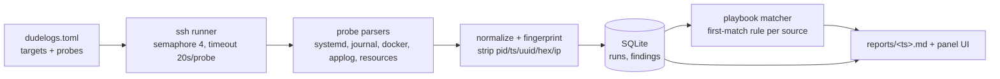

# dudelogs — rencana

> Catatan: implementasi v1 sudah ada, dan koneksi/project kini disimpan di SQLite
> (dikelola dari UI), bukan lagi di `[[target]]` TOML. Lihat `README.md` untuk
> cara pakai aktual; dokumen ini menyimpan alasan desain awal.

Aplikasi desktop lokal (Rust) yang menarik error dari beberapa VM via SSH, menormalkan &
mendeduplikasi temuan, lalu menghasilkan **fix plan** yang bisa dieksekusi.

## Keputusan stack (dan alasannya)

| Keputusan | Pilihan | Alasan | Biaya ganti |
|---|---|---|---|
| GUI | `eframe`/`egui` (native, satu binary) | Tanpa Node/webview; tabel + panel detail sudah cukup | Rendah: UI dipisah di `src/ui/`, backend murni Rust |
| SSH | Shell-out ke `/usr/bin/ssh` | Langsung pakai `~/.ssh/config`, ssh-agent, ProxyJump, key hardware, known_hosts. `russh` = implement ulang auth + host key + jump chain | Rendah: semua di `src/ssh.rs` |
| Fix plan | Rules engine deterministik (`playbook.toml`), LLM opsional fase 2 | Offline, gratis, bisa di-review; LLM hanya *enrichment* per fingerprint (di-cache, tak bayar dua kali) | — |
| Simpan | SQLite (`rusqlite`, bundled) | Perlu history "error baru vs sudah dikenal" + cache plan | — |
| Probe | Read-only, satu `ssh` per probe | Isolasi: probe hang di-kill tanpa merusak yang lain; 5 koneksi/target/run murah | Naikkan ke 1 koneksi/target kalau >50 VM |

Bukan pilihan: Tauri (butuh toolchain Node + webview, tanpa manfaat untuk UI tabel), auto-fix/remote mutation (non-goal v1, lihat bawah).

## Alur run



## Model data

```rust
struct Finding {
    fingerprint: String,   // blake3(canonical(source, unit, message))[:16]
    target: String,        // nama target, bukan host
    project: String,       // tag project dari config
    source: Source,        // Systemd | Journal | Docker | AppLog | Resource
    severity: Severity,    // Critical | Error | Warning | Info
    message: String,       // 1 baris, setelah redaksi
    excerpt: String,       // maks 20 baris konteks
    first_seen: DateTime,  // dari DB; "NEW" bila run pertama
    occurrences: u32,      // hitungan lintas run
}
```

Dedup: `UNIQUE(fingerprint, target)`; tampilan mengelompokkan per `fingerprint` supaya "error sama di 3 VM" jadi satu baris dengan 3 target.

```sql
CREATE TABLE runs(id INTEGER PRIMARY KEY, started_at TEXT, finished_at TEXT, status TEXT, targets_ok INT, targets_fail INT);
CREATE TABLE findings(fingerprint TEXT, target TEXT, project TEXT, source TEXT, severity TEXT,
  message TEXT, excerpt TEXT, first_seen_run INT, last_seen_run INT, occurrences INT,
  PRIMARY KEY(fingerprint, target));
CREATE TABLE plan_cache(fingerprint TEXT PRIMARY KEY, plan_json TEXT, created_at TEXT);
```

## Probe v1 (semua read-only, `LC_ALL=C`, `BatchMode=yes`, `ConnectTimeout=10`)

| Probe | Perintah | Severity |
|---|---|---|
| systemd | `systemctl --failed --no-legend --plain --no-pager` | Error |
| journal | `journalctl -p 3 -o json --since '-2 hours' --no-pager -n 500` (parse `MESSAGE`, `_SYSTEMD_UNIT`, `PRIORITY`) | Critical (pri 0–2) / Error |
| docker | `docker ps -a --filter status=exited --filter status=dead --format '{{.Names}}\t{{.Image}}\t{{.Status}}'`; restart loop: `grep Restarting` | Warning (exit 0 → Info) |
| applog | `tail -n 400 <log_globs> \| grep -aiE 'panic\|ERROR\|FATAL\|Exception'` | Error |
| resources | `df -P -x tmpfs -x devtmpfs`, `/proc/meminfo`, `/proc/loadavg` vs `nproc` | Warning >90% / load > 2×core |

Aturan keras: definisi perintah divalidasi saat load config — tolak `sudo`, `;`, `&&`, `>`, `rm`, `curl`, `wget`, pipe tulis. Target tidak pernah dimutasi.

## Playbook (inti "fix plan")

`playbook.toml` dibundel via `include_str!`, bisa ditimpa di `~/.dudelogs/playbook.toml`. Match = `(source, regex message, severity_min)`, first-match menang, lalu render template `{{unit}}`, `{{target}}`, `{{path}}`.

```toml
[[rule]]
id = "systemd.failed"
match = { source = "systemd" }
severity_min = "error"
cause = "Unit gagal start / berhenti"
steps = [
  "systemctl status {{unit}} -l --no-pager",
  "journalctl -u {{unit}} -n 200 --no-pager",
  "bandingkan config terakhir yang berubah (git log / mtime di /etc)"
]
verify = "systemctl is-active {{unit}}"
risk = "low"
```

Setiap temuan tanpa rule dapat template triage generik + label `confidence = "low"`, bukan plan karangan.

Contoh markdown report:

```markdown
## [ERROR] nginx.service failed — 3 target (vm-web-01, vm-web-02, vm-web-03)
fingerprint: 9f2c1a...
first seen: 2026-11-16 21:04 · occurrences: 7

Cause: Unit gagal start / berhenti
1. systemctl status nginx.service -l --no-pager
2. journalctl -u nginx.service -n 200 --no-pager
3. bandingkan config terakhir yang berubah
Verify: systemctl is-active nginx.service
```

## Modul

```
src/main.rs          bootstrap eframe
src/config.rs        AppConfig/Target/ProbeSet (toml) + validasi perintah
src/ssh.rs           run(target, cmd) -> Output; timeout, kill child, env LC_ALL=C
src/probe/*.rs       systemd, journal, docker, applog, resources: (Output) -> Vec<Finding>
src/normalize.rs     strip pid/ts/uuid/hex/ipv4 → fingerprint
src/redact.rs        bearer/JWT/password=/AKIA/base64 panjang → `***`
src/store.rs         rusqlite: upsert run, tandai NEW vs known
src/playbook.rs      load, match, render
src/report.rs        markdown builder
src/ui/              app.rs (tabel + filter), detail.rs (plan + copy)
```

Path runtime: `~/.dudelogs/{state.db, reports/, raw/<run_id>/<target>/<probe>.txt}`.

## Milestone & kriteria lulus

| # | Isi | Lulus bila |
|---|---|---|
| M0 | `rustup` (belum ada di mesin ini), `cargo new`, load `dudelogs.toml`, validasi perintah | `cargo run` menampilkan daftar target; config dengan `sudo` ditolak + pesan jelas |
| M1 | `ssh.rs` + probe systemd, temuan tampil di UI | stub SSH (`DUDELOGS_SSH_BIN=tests/stub-ssh`) menghasilkan 1 temuan; uji manual `ssh -o BatchMode=yes <host> 'systemctl --failed'` |
| M2 | journal + docker + applog + resources, concurrency 4, timeout | fixture parse test hijau; host mati → run selesai dengan `targets_fail=1`, tidak hang |
| M3 | SQLite + NEW vs known | run 2× tanpa perubahan → 0 NEW; error baru → 1 NEW |
| M4 | playbook + report markdown | golden-file test: findings fixture → report identik |
| M5 | UI: filter severity/project, NEW-only, progress per target, copy markdown | manual: run 3 target, pilih temuan, copy menghasilkan blok yang sama dengan report |
| M6 | hardening: redaksi, 1000 findings < 200 ms render, `cargo bundle` → `.app` | test redaksi tidak meloloskan token; app jalan dari Finder |

Urutan pengerjaan: M0→M1 adalah **vertical slice** yang harus jalan dulu; M2–M4 tanpa UI pun sudah berguna (CLI `--headless` untuk cron harian, 10 baris tambahan di `main.rs`).

## Non-goal v1

Auto-fix / eksekusi perbaikan di remote · install agent di VM · alerting/paging · server multi-user · chart historis · streaming live · target Windows · distro non-systemd (applog masih jalan) · LLM wajib.

## Risiko & mitigasi

| Risiko | Mitigasi |
|---|---|
| Key berpassphrase / butuh password → `ssh` gagal non-interaktif | Wajib ssh-agent; UI menampilkan error auth per target, bukan hang. Tidak ada prompt TTY |
| `journalctl` butuh grup `adm`/`systemd-journal`, `docker` butuh grup `docker` | Probe melaporkan "permission denied" sebagai `ProbeError` terpisah, bukan "tidak ada error" |
| Output ter-lokalisasi | Selalu `LC_ALL=C`, parse berdasarkan field bukan teks kalimat |
| Log membanjir / secrets bocor | Batas `-n` per probe, redaksi sebelum simpan/tampil, raw hanya lokal, excerpt ≤20 baris |
| Salah kira "tidak ada error" | Setiap probe punya 3 status: Ok(kosong) / Ok(temuan) / Error(probe gagal) — status ketiga selalu terlihat di UI & report |
| Jam beda antar VM | Waktu ditandai dari sisi lokal (`started_at`), jam remote hanya info |

## Yang perlu kamu isi (tidak memblokir M0–M1)

1. Daftar host/user/peran + project tiap VM (`dudelogs.toml`).
2. Path log aplikasi per project (default: kosong → probe applog dilewati).
3. LLM enrichment: ya/tidak di fase 2 — kalau ya, endpoint mana.
4. Konvensi severity internal kalau ada (mis. semua `journal -p3` = error).

## Definisi selesai v1

Satu klik "Run" → semua target dicek paralel → daftar temuan terdedup dengan penanda NEW → tiap temuan punya langkah perbaikan + perintah verifikasi → satu file `~/.dudelogs/reports/<ts>.md` bisa ditempel ke tiket.
